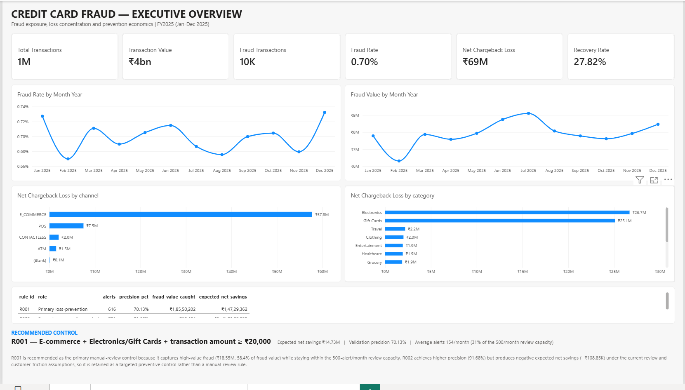
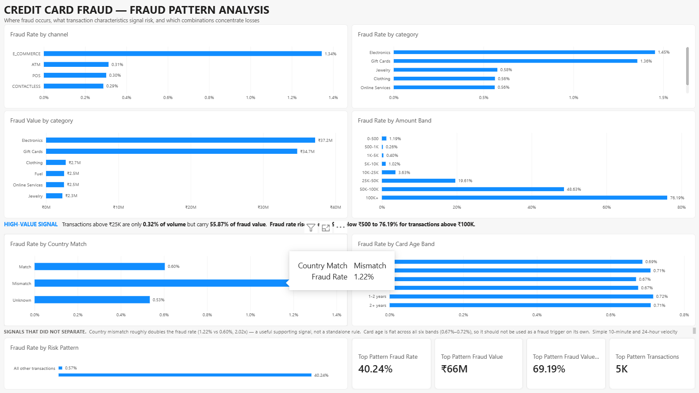

# Credit Card Fraud Pattern and Loss Analysis

> **End-to-end Data Analytics project focused on identifying credit-card fraud patterns, quantifying financial losses, optimizing fraud rules, and recommending a financially viable prevention strategy.**

---

## 📌 Project Overview

This project simulates a real-world credit-card fraud analytics problem for a fictional Indian bank experiencing increasing fraud losses.

The objective is not simply to identify fraudulent transactions. The project focuses on the complete business decision process:

**Data Generation → Data Quality → SQL Analysis → Fraud Pattern Discovery → Rule Simulation → Time-Based Validation → Business Impact → Power BI → Recommendation**

The final objective is to answer:

> **Which fraud-prevention rule should the bank implement to reduce fraud losses while keeping false positives, customer friction, and review workload under control?**

---

# 🎯 Business Problem

The fictional bank is facing increasing credit-card fraud losses.

The fraud analytics team needs to determine:

1. **How much fraud is occurring?**
2. **Where are fraud losses concentrated?**
3. **Which transaction patterns are strongly associated with fraud?**
4. **Which fraud rules can capture significant fraud value?**
5. **How many legitimate customers would be affected?**
6. **Can the fraud-review team handle the resulting alert volume?**
7. **Which rule provides the best financial outcome?**

The final deliverable is a **rule-change recommendation with an estimated rupee value**.

---

# 🏗️ Project Architecture

```text
                    ┌─────────────────────┐
                    │ Synthetic Data      │
                    │ Generation          │
                    └──────────┬──────────┘
                               │
                               ▼
                    ┌─────────────────────┐
                    │ Raw Data + Hidden   │
                    │ Ground Truth        │
                    └──────────┬──────────┘
                               │
                               ▼
                    ┌─────────────────────┐
                    │ Data Quality &      │
                    │ Cleaning            │
                    └──────────┬──────────┘
                               │
                               ▼
                    ┌─────────────────────┐
                    │ Dimension &         │
                    │ Chargeback QA       │
                    └──────────┬──────────┘
                               │
                               ▼
                    ┌─────────────────────┐
                    │ SQLite Star Schema  │
                    └──────────┬──────────┘
                               │
                               ▼
                    ┌─────────────────────┐
                    │ SQL Analysis        │
                    │ • Baseline          │
                    │ • Loss              │
                    │ • Velocity          │
                    │ • Cohorts           │
                    └──────────┬──────────┘
                               │
                               ▼
                    ┌─────────────────────┐
                    │ Pattern Discovery   │
                    │ & Rule Simulation   │
                    └──────────┬──────────┘
                               │
                               ▼
                    ┌─────────────────────┐
                    │ Development /       │
                    │ Validation Split    │
                    └──────────┬──────────┘
                               │
                               ▼
                    ┌─────────────────────┐
                    │ Hidden Ground Truth │
                    │ Final Validation    │
                    └──────────┬──────────┘
                               │
                               ▼
                    ┌─────────────────────┐
                    │ Business Case       │
                    │ & Rule Economics    │
                    └──────────┬──────────┘
                               │
              ┌────────────────┴────────────────┐
              │                                 │
              ▼                                 ▼
       ┌───────────────┐                 ┌───────────────┐
       │ Excel         │                 │ Power BI      │
       │ Business Case │                 │ Dashboard     │
       └───────────────┘                 └───────────────┘
              │                                 │
              └────────────────┬────────────────┘
                               ▼
                    ┌─────────────────────┐
                    │ Final Recommendation│
                    │ Memo                │
                    └─────────────────────┘
```

---

# 🛠️ Technology Stack

| Area | Technology |
|---|---|
| Programming | Python |
| Data Manipulation | Pandas, NumPy |
| Data Generation | Faker |
| Statistics | SciPy |
| Machine Learning Benchmark | Scikit-learn |
| Computer Environment | VS Code |
| Database | SQLite |
| SQL | SQLite SQL |
| Data Validation | Pandas + SQL |
| Excel Analysis | Microsoft Excel |
| Visualization | Power BI |
| Documentation | Markdown |
| Version Control | Git |

---

# 📊 Dataset

The project uses a **synthetically generated banking dataset** designed to reproduce realistic fraud-analysis challenges.

The generated data contains:

- 20,000 customers
- 30,000 cards
- 2,000 merchants
- ~1.5 million transactions
- 10,500 chargebacks
- 6 fraud typologies
- 12 months of transaction history

The data-generation design includes normal customer behavior, seasonal effects, transaction channels, merchant categories, fraud typologies, chargeback delays, and intentionally injected data-quality problems.

---

# 🗂️ Data Model

The analytical layer follows a star-schema design.

### Dimension tables

```text
dim_customer
dim_card
dim_merchant
dim_device
dim_date
dim_rule
```

### Fact tables

```text
fact_transaction
fact_chargeback
fact_rule_alert
```

The project also maintains a separate:

```text
sim_ground_truth
```

dataset containing hidden synthetic fraud information.

The hidden ground truth is deliberately kept separate from the analytical layer until final validation to reduce leakage during rule development.

---

# 🧹 Data Quality & Cleaning

The raw data intentionally contains realistic data-quality problems.

Examples include:

- Duplicate transactions
- Invalid transaction amounts
- Missing device IDs
- Missing IP-country values
- Orphan merchant IDs
- Inconsistent city names
- Mixed timestamp formats
- Chargebacks without matching cleaned transactions

### Cleaning performed

#### Duplicate transactions

Exact duplicate transaction rows were identified and removed.

#### Invalid amounts

Transactions with:

```text
amount <= 0
```

were removed.

#### Merchant referential integrity

Transactions referencing nonexistent merchants were removed.

#### City standardization

The following variants were standardized:

```text
Bangalore
BLR
    ↓
Bengaluru
```

#### Missing device IDs

Missing device IDs were mapped to an explicit unknown-device member:

```text
device_id = -1
device_type = UNKNOWN
```

#### Missing IP country

Missing values were mapped to:

```text
UNKNOWN
```

---

# 💳 Chargeback Reconciliation

The project does not simply discard chargeback records that fail to match the cleaned transaction table.

After reconciliation:

- 10,500 chargebacks were retained
- 10,488 matched cleaned transactions
- 12 chargebacks remained orphaned

The 12 orphan chargebacks were retained because they represent valid financial records from the raw data.

Their financial impact was:

```text
Gross loss:       ₹88,077.08
Recovered:        ₹35,232.28
Net loss:         ₹52,844.80
```

These records are included in the overall chargeback-loss baseline but excluded from transaction-linked channel/category analysis.

---

# 📈 Fraud Baseline

The cleaned analytical dataset contains:

| Metric | Result |
|---|---:|
| Transactions | 1,498,353 |
| Transaction Value | ₹3.76B |
| Average Transaction | ₹2,511.30 |
| Median Transaction | ₹1,495.02 |
| Confirmed Fraud Transactions | 10,488 |
| Fraud Rate | 0.70% |
| Fraud Transaction Value | ₹95.20M |
| Fraud Value Share | 2.53% |
| Gross Chargeback Loss | ₹95.29M |
| Recovered Amount | ₹26.51M |
| Net Chargeback Loss | ₹68.78M |
| Recovery Rate | 27.82% |

---

# 🔎 Key Fraud Findings

## 1. E-commerce is the dominant fraud channel

E-commerce transactions have a significantly higher fraud rate than POS, contactless and ATM transactions.

| Channel | Fraud Rate |
|---|---:|
| E-commerce | **1.34%** |
| POS | 0.30% |
| Contactless | 0.29% |
| ATM | 0.31% |

E-commerce accounts for approximately:

> **84% of total net chargeback loss.**

---

## 2. Electronics and Gift Cards dominate fraud losses

The two strongest categories are:

```text
Electronics
Gift Cards
```

Combined, they account for approximately:

> **75% of total net chargeback loss.**

---

## 3. High-value transactions are disproportionately risky

Transactions above ₹25,000 represent only a very small share of transaction volume but account for approximately:

> **56% of fraud value.**

This makes transaction value one of the strongest financial signals.

---

## 4. Country mismatch is a useful supporting signal

Transactions with a country/IP mismatch show approximately twice the fraud rate of transactions without a mismatch.

However, mismatch alone is not sufficiently selective to become the primary fraud rule.

---

## 5. Card age is not a strong standalone signal

Fraud rates remain relatively stable across card-age cohorts.

Therefore:

> **Card age should not be used as a standalone fraud rule.**

---

## 6. Velocity is not a strong standalone signal

10-minute, 1-hour and 24-hour transaction velocity were analyzed.

The observed velocity patterns did not provide enough discrimination to justify using velocity as the primary standalone rule.

Velocity can instead be used as a supporting signal.

---

# 🚨 Strongest Fraud Pattern

The strongest observed pattern was:

```text
E_COMMERCE
+
(Electronics OR Gift Cards)
+
Amount >= ₹10,000
```

This pattern produced:

| Metric | Result |
|---|---:|
| Transactions | 4,938 |
| Fraud Transactions | 1,987 |
| Fraud Rate | **40.24%** |
| Fraud Value | ₹65.86M |
| Fraud Value Coverage within Pattern | 95.27% |

This became the foundation for the final rule optimization.

---

# ⚙️ Fraud Rule Optimization

Multiple thresholds were tested instead of choosing a threshold arbitrarily.

| Threshold | Alerts | Fraud | Precision |
|---:|---:|---:|---:|
| ₹10K | 4,938 | 1,987 | 40.24% |
| ₹15K | 2,691 | 1,627 | 60.46% |
| ₹20K | 1,793 | 1,318 | 73.51% |
| ₹25K | 1,314 | 1,065 | 81.05% |
| ₹30K | 978 | 840 | 85.89% |
| ₹40K | 585 | 528 | 90.26% |
| ₹50K | 344 | 322 | 93.60% |

The threshold cannot be selected using precision alone.

A higher threshold improves precision but reduces fraud value captured.

Therefore, the final decision considers:

- Fraud value captured
- Precision
- False positives
- Alert volume
- Review capacity
- Customer friction
- Expected net savings

---

# 🧪 Time-Based Validation

To avoid evaluating the rule on the same period used for tuning, the dataset was split chronologically.

```text
Development
January 2025 → August 2025

Validation
September 2025 → December 2025
```

The final rules were evaluated against the held-out validation period.

This approach helps reduce future-information leakage and provides a more realistic estimate of how the rule may behave on unseen transactions.

---

# 🏆 Final Recommended Rule

## R001 — Primary Fraud Review Rule

```text
Channel = E_COMMERCE
AND
Category IN (Electronics, Gift Cards)
AND
Transaction Amount >= ₹20,000
```

---

# 📊 R001 Validation Performance

| Metric | Result |
|---|---:|
| Alerts | 616 |
| True Positives | 432 |
| False Positives | 184 |
| Precision | **70.13%** |
| Recall | 12.26% |
| Fraud Value Caught | **₹18.55M** |
| Fraud Value Coverage | **58.35%** |
| Alerts / Month | ~154 |
| Review Capacity | 500 / month |
| Capacity Utilization | **30.8%** |

The rule therefore remains within the assumed review-team capacity.

---

# 💰 Business Case

The following assumptions were used:

| Assumption | Value |
|---|---:|
| Fraud prevention rate | 80% |
| Review cost / alert | ₹150 |
| Customer friction / legitimate alert | ₹100 |
| Review capacity / month | 500 alerts |

### R001

```text
Expected prevented loss       ₹14.84M
Review cost                    ₹92.40K
Customer friction cost         ₹18.40K
Expected net savings          ₹14.73M
```

Therefore:

> **R001 produces approximately ₹14.73M expected net savings under the assumed business conditions.**

---

# 🔬 Secondary Rule

## R002 — Card Testing Control

```text
Channel = E_COMMERCE
AND
Amount <= ₹50
```

Validation results:

| Metric | Result |
|---|---:|
| Alerts | 781 |
| Fraud | 716 |
| Legitimate | 65 |
| Precision | **91.68%** |
| Fraud Value Caught | ₹18.49K |
| Expected Net Savings | **-₹108.85K** |

R002 has extremely strong precision and captures card-testing activity effectively.

However, the monetary value captured is very small compared with R001.

Therefore:

> **R002 should be considered an automated preventive card-testing control rather than a manual-review rule.**

---

# 🧩 Fraud Typology Analysis

The project contains six fraud typologies:

```text
1. Account Takeover
2. Card Testing
3. CNP High-Risk Merchant
4. Compromised Terminal
5. Cross-Border Spike
6. Impossible Travel
```

R001 primarily captures high-value account-takeover activity.

### R001

```text
Account Takeover Recall       ~61.9%
Account Takeover Value Cover  ~84.1%
```

R001 has limited coverage of other typologies.

### R002

R002 captures:

```text
Card Testing
```

with:

```text
100% recall
100% fraud-value coverage
```

This demonstrates why a **multi-rule fraud strategy** is preferable to relying on a single universal rule.

---

# 💡 Final Business Recommendation

### Primary recommendation

Deploy:

```text
R001:
E_COMMERCE
AND Category IN (Electronics, Gift Cards)
AND Amount >= ₹20,000
```

as the primary manual-review fraud-loss prevention rule.

### Secondary recommendation

Retain R002 as an automated or targeted card-testing control.

### Operational recommendation

R001 generates approximately:

```text
154 alerts/month
```

against an assumed:

```text
500 alerts/month
```

review capacity.

Therefore:

```text
Capacity utilization ≈ 30.8%
```

This leaves room for additional fraud controls.

---

# 📊 Power BI Dashboard

The project contains a three-page Power BI dashboard.

## Page 1 — Executive Overview

Focus:

- Overall transaction volume
- Transaction value
- Fraud rate
- Fraud value
- Net chargeback loss
- Recovery rate
- Monthly fraud trends
- Channel-level losses
- Category-level losses
- Rule economics
- Final recommendation



---

## Page 2 — Fraud Pattern Analysis

Focus:

- Fraud rate by channel
- Fraud rate by category
- Fraud value by category
- Fraud rate by amount band
- Country mismatch
- Card age
- High-value fraud concentration
- Strongest fraud pattern



---

## Page 3 — Rule Performance & Optimization

Focus:

- Rule comparison
- Validation precision
- Fraud value captured
- Expected net savings
- Threshold trade-offs
- Typology-level performance
- Review capacity
- Final rule recommendation


---

# 📗 Excel Business Case

The Excel workbook contains:

```text
Summary
Assumptions
Rule Results
Capacity
Sensitivity
Typology Performance
```

The workbook is used to evaluate:

- Rule economics
- Review cost
- Customer friction
- Fraud prevention assumptions
- Capacity utilization
- Sensitivity to fraud-prevention effectiveness
- Fraud typology coverage

File:

```text
excel/fraud_rule_business_case.xlsx
```

---

# ⚡ SQL Performance Optimization

During the velocity analysis, the original SQL implementation used correlated subqueries.

The query was optimized using window functions.

Performance improved from approximately:

```text
16 minutes
    ↓
38.4 seconds
```

This represents approximately:

> **96% runtime reduction / ~25× faster execution**

while maintaining the analytical logic.

---

# 🗃️ SQL Analysis Modules

The SQL layer is divided into focused analytical modules:

```text
01_baseline_analysis.sql
02_fraud_concentration.sql
03_velocity_analysis.sql
04_fraud_loss_analysis.sql
05_rule_simulation.sql
06_temporal_cohort_analysis.sql
07_data_quality_checks.sql
08_final_rule_results.sql
```

### Analysis covered

- Fraud baseline
- Fraud concentration
- Channel analysis
- Category analysis
- Amount thresholds
- Velocity
- Fraud loss
- Monthly trends
- Card-age cohorts
- Rule simulation
- Rule stability
- Data-quality validation
- Final rule results

---

# 📁 Project Structure

```text
fraud-loss-analysis/
│
├── data/
│   ├── raw/
│   │   ├── customers.csv
│   │   ├── cards.csv
│   │   ├── merchants.csv
│   │   ├── transactions.csv
│   │   ├── chargebacks.csv
│   │   └── sim_ground_truth.csv
│   │
│   ├── processed/
│   │   ├── dim_customer.csv
│   │   ├── dim_card.csv
│   │   ├── dim_merchant.csv
│   │   ├── dim_device.csv
│   │   ├── fact_transaction_clean.csv
│   │   ├── fact_chargeback.csv
│   │   └── data_quality_log.csv
│   │
│   └── fraud_analysis.db
│
├── python/
│   ├── generate_data.py
│   ├── 01_data_quality_and_cleaning.ipynb
│   ├── 02_dimension_and_chargeback_cleaning.ipynb
│   ├── 03_fraud_baseline_and_eda.ipynb
│   ├── 05_sql_analysis.ipynb
│   ├── 06_final_validation.ipynb
│   ├── 08_final_rule_validation.ipynb
│   └── 09_business_case.ipynb
│
├── sql/
│   ├── 01_baseline_analysis.sql
│   ├── 02_fraud_concentration.sql
│   ├── 03_velocity_analysis.sql
│   ├── 04_fraud_loss_analysis.sql
│   ├── 05_rule_simulation.sql
│   ├── 06_temporal_cohort_analysis.sql
│   ├── 07_data_quality_checks.sql
│   └── 08_final_rule_results.sql
│
├── excel/
│   └── fraud_rule_business_case.xlsx
│
├── powerbi/
│   └── Credit_Card_Fraud_Analysis.pbix
│
├── images/
│   ├── dashboard_page1.png
│   ├── dashboard_page2.png
│   └── dashboard_page3.png
│
├── docs/
│   ├── Credit_Card_Fraud_Recommendation_Memo.md
│   └── config.yaml
│
├── requirements.txt
└── README.md
```

---

# 🚀 How to Run the Project

## 1. Clone the repository

```bash
git clone <repository-url>
cd fraud-loss-analysis
```

## 2. Create a virtual environment

### Windows

```powershell
python -m venv .venv
.venv\Scripts\Activate.ps1
```

## 3. Install dependencies

```bash
pip install -r requirements.txt
```

## 4. Generate the synthetic data

```bash
python python/generate_data.py
```

## 5. Run the notebooks

Open the project in VS Code and run the notebooks in sequence:

```text
01_data_quality_and_cleaning.ipynb
        ↓
02_dimension_and_chargeback_cleaning.ipynb
        ↓
03_fraud_baseline_and_eda.ipynb
        ↓
05_sql_analysis.ipynb
        ↓
06_final_validation.ipynb
        ↓
08_final_rule_validation.ipynb
        ↓
09_business_case.ipynb
```

---

# 📌 Important Analytical Design Decisions

## Hidden ground truth separation

Fraud ground truth is not used during normal exploratory analysis and rule development.

It is accessed during the final validation stage.

This helps prevent information leakage.

---

## Time-based validation

The rule is tuned on earlier months and evaluated on later months.

```text
Development: January → August
Validation:  September → December
```

This better reflects how a fraud rule would be evaluated in a production environment.

---

## Business-oriented rule evaluation

Rules are not evaluated using precision or recall alone.

The project considers:

```text
Fraud value
+
Precision
+
False positives
+
Alert volume
+
Customer friction
+
Review cost
+
Review capacity
+
Expected net savings
```

This keeps the analysis aligned with the actual business decision.

---

# ⚠️ Limitations

This is a synthetic-data portfolio project.

Therefore:

- Customer behavior is simulated.
- Fraud typologies are synthetic.
- Chargeback outcomes are synthetic.
- Review costs are assumptions.
- Customer-friction costs are assumptions.
- Fraud prevention effectiveness is assumed at 80%.
- Production fraud behavior may differ substantially.
- Real-world model/rule performance requires monitoring and recalibration.

The recommended rule should therefore be viewed as a **decision-support prototype** rather than a production fraud-control policy.

---

# 🔮 Future Improvements

Possible next iterations include:

### 1. Real-time fraud scoring

Move from batch SQL analysis to streaming transaction scoring.

### 2. Machine-learning benchmark

Compare rule-based detection with:

- Logistic Regression
- Random Forest
- XGBoost
- Gradient Boosting

### 3. Feature engineering

Introduce:

- Customer spend deviation
- Merchant risk score
- Device novelty
- IP reputation
- Transaction velocity
- Historical category behavior
- Customer-level anomaly scores

### 4. Automated rule optimization

Use cost-sensitive optimization to automatically select thresholds.

### 5. Production monitoring

Track:

- Precision drift
- Fraud-rate drift
- Alert volume
- Customer complaints
- Rule coverage
- Financial savings

### 6. Multi-rule orchestration

Build a rule hierarchy covering:

```text
Account Takeover
Card Testing
CNP Fraud
Compromised Terminal
Cross-Border Fraud
Impossible Travel
```

---

# 👤 Skills Demonstrated

This project demonstrates practical experience in:

### Python

- Pandas
- NumPy
- Data cleaning
- Feature engineering
- Statistical analysis
- Validation

### SQL

- CTEs
- Aggregations
- Window functions
- CASE statements
- Conditional analysis
- Cohort analysis
- Threshold analysis
- Query optimization
- Data-quality checks

### Data Analytics

- Exploratory Data Analysis
- Fraud pattern discovery
- Loss analysis
- Time-based validation
- Business-rule optimization
- Sensitivity analysis

### Excel

- Business-case modeling
- Cost-benefit analysis
- Sensitivity analysis
- Scenario analysis

### Power BI

- Data modeling
- Star schema
- DAX
- KPI development
- Interactive dashboards
- Business storytelling

### Business Analysis

- Financial impact estimation
- Operational capacity analysis
- Customer-friction trade-offs
- Fraud strategy recommendation

---

# 🏁 Final Outcome

The analysis recommends:

> ### **R001 — E-commerce + Electronics/Gift Cards + Amount ≥ ₹20,000**

as the primary manual-review fraud prevention rule.

Under the project assumptions, the rule produces:

```text
₹18.55M fraud value caught
₹14.73M expected net savings
~154 alerts/month
30.8% review-capacity utilization
70.13% validation precision
```

A complementary low-value e-commerce rule, R002, is recommended as a targeted automated card-testing control rather than a manual-review rule.

The project demonstrates how a Data Analyst can move from **raw transaction data to an evidence-backed business decision with measurable financial impact**.

---

## 📄 Project Deliverables

| Deliverable | Location |
|---|---|
| Python notebooks | `python/` |
| SQL analysis | `sql/` |
| Clean datasets | `data/processed/` |
| SQLite database | `data/fraud_analysis.db` |
| Excel business case | `excel/fraud_rule_business_case.xlsx` |
| Power BI dashboard | `powerbi/` |
| Dashboard screenshots | `images/` |
| Recommendation memo | `docs/` |
| Project documentation | `README.md` |

---

## ⭐ Key Takeaway

This project goes beyond:

> **"Find fraudulent transactions."**

It answers the more important business question:

> **"Which fraud intervention should the bank actually implement, how much money could it save, and can the operations team handle it?"**

That is the core objective of this fraud analytics project.
